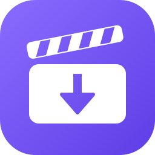

<p align="center">
  
</p>

<h1 align="center">YT DLP Studio</h1>

<p align="center">
  A friendly Windows app for <a href="https://github.com/yt-dlp/yt-dlp">yt-dlp</a>: download music and video
  from YouTube, SoundCloud, Bandcamp and the
  <a href="https://github.com/yt-dlp/yt-dlp/blob/master/supportedsites.md">thousands of other sites</a> it supports.
</p>

> [!NOTE]
> **This project is entirely vibe-coded.** I don't know C#. Every line was written by an AI
> assistant ([Claude Code](https://claude.com/claude-code)) while I described what I wanted and
> tested the result. I built it for my own use. You're welcome to use it, fork it or borrow from it,
> but nobody with C# experience has reviewed it, and it comes with no warranty or support.
>
> YT DLP Studio is an independent project. It isn't made by, or affiliated with, the yt-dlp team.

## Features

- **Paste and go:** paste one or more links (or use *Paste from clipboard*) and press Download or Ctrl+Enter.
- **Formats:** MP3, M4A, FLAC, WAV, Video (MP4), or Custom (only your own options).
- **Quality:** choose the audio bitrate (Best, 320 down to 96 kbps) and the video quality (Best compatible,
  Best available, or a cap from 4K down to 360p). This works for any number of links and for playlists.
- **Check formats:** for a single link, see its thumbnail, title and every available video and audio
  stream with its size, then pick exact ones. The estimated download size updates as you choose.
- **Cover art and tags:** optionally embed the thumbnail and title/artist metadata.
- **Download queue:** each video gets a card with its thumbnail, title, progress, speed, size and
  time left, plus buttons to cancel, retry, show the file in its folder or remove the card. Playlists get one card per video.
- **All yt-dlp options:** the Options page lists every option your version of yt-dlp has, read
  from `yt-dlp --help`, with search and sections. Your choices are remembered.
- **Sets itself up:** on first run it finds or downloads yt-dlp and FFmpeg, and it checks for yt-dlp updates on every launch.
- **Looks at home on Windows 11:** follows your light or dark mode setting and uses the Mica background.

## Getting started

1. Download `yt-dlp-studio.exe` from the [Releases](../../releases) page, or build it yourself (see below).
2. Put it in its own folder and run it.
3. On first run it downloads anything missing into that folder, from the tools' official GitHub
   releases:
   - `yt-dlp.exe` (about 17 MB)
   - FFmpeg (about 85 MB)

   If you already have them next to the app or on your PATH, it uses those instead.

**"Windows protected your PC"?** The exe isn't code-signed, so SmartScreen warns about it. Click
**More info → Run anyway**, or build it from source yourself.

Requires Windows 10 or 11. Nothing else needs to be installed; the app uses .NET Framework 4.8,
which comes with Windows.

## Building from source

No Visual Studio or SDK needed. The C# compiler that ships with Windows is enough:

```bat
src\build.bat
```

This produces `yt-dlp-studio.exe` in the repository root.

| File | What it is |
| --- | --- |
| `src/MainWindow.xaml` | The whole interface: layout, styles, light/dark colours |
| `src/YtDlpStudio.cs` | Everything else: running yt-dlp, the download queue, the options page, setup |
| `src/make-icon.ps1` | Draws the logo and writes `assets/logo.svg`, `assets/logo.png` and `src/app.ico` |
| `src/build.bat` | Builds the exe |

## Files the app creates

These are created next to the exe, or in `%LOCALAPPDATA%\yt-dlp-studio` if that folder isn't writable:

- `yt-dlp-studio.settings`: your folder, format and options.
- `yt-dlp-help.txt`: a cached copy of yt-dlp's option list.
- `yt-dlp.exe` and `ffmpeg\`: only if the app downloaded them.

Downloads go to the `downloads` folder next to the exe unless you choose another folder.

## Please use responsibly

Only download content you have the right to download, and respect each site's terms of service and
copyright law where you live. This project isn't affiliated with YouTube or any other site.

## Credits

- **[yt-dlp](https://github.com/yt-dlp/yt-dlp)** does all the actual downloading. This app is just a front end for it. (Unlicense)
- **[FFmpeg](https://ffmpeg.org)** converts the audio, merges video and embeds cover art,
  using the Windows builds from **[yt-dlp/FFmpeg-Builds](https://github.com/yt-dlp/FFmpeg-Builds)**. (LGPL/GPL; build scripts MIT)
- **[imsyy/yt-dlp-gui](https://github.com/imsyy/yt-dlp-gui)** inspired the Home / Downloads design
  and the download cards. No code was copied. (MIT)
- **Segoe Fluent Icons** by Microsoft, for the icons inside the interface.
- Written by **[Claude Code](https://claude.com/claude-code)** (Anthropic).

See [THIRD-PARTY-NOTICES.md](THIRD-PARTY-NOTICES.md) for the licence details.

## License

[MIT](LICENSE) © 2026 Atsukio. This covers the app's own code and its logo.
